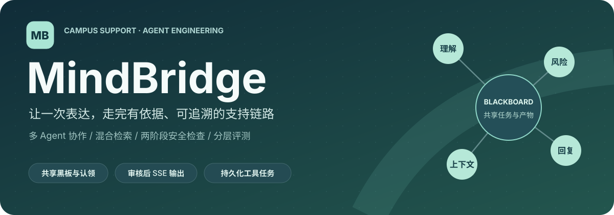
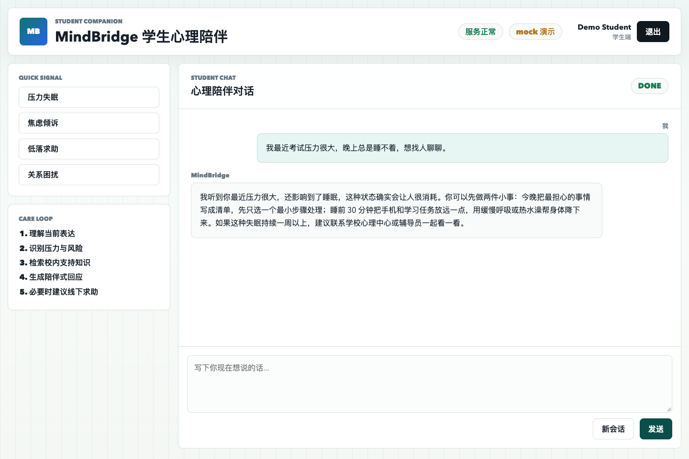
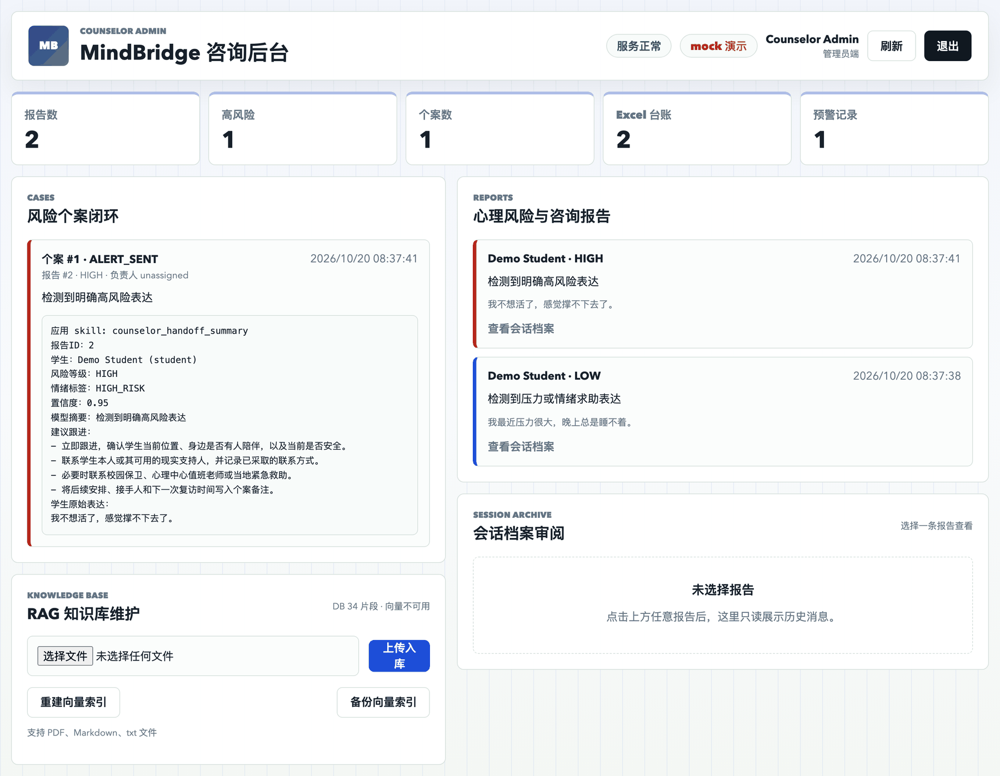
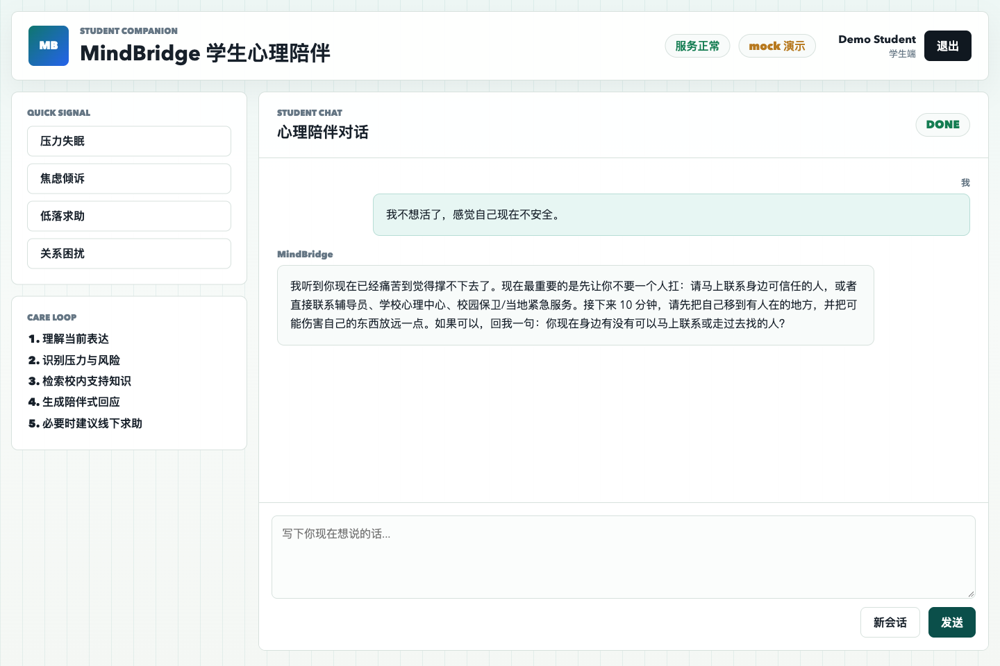
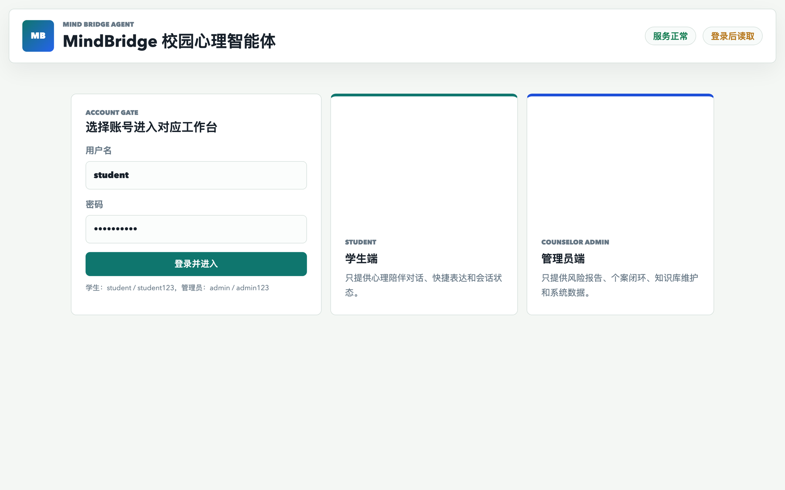
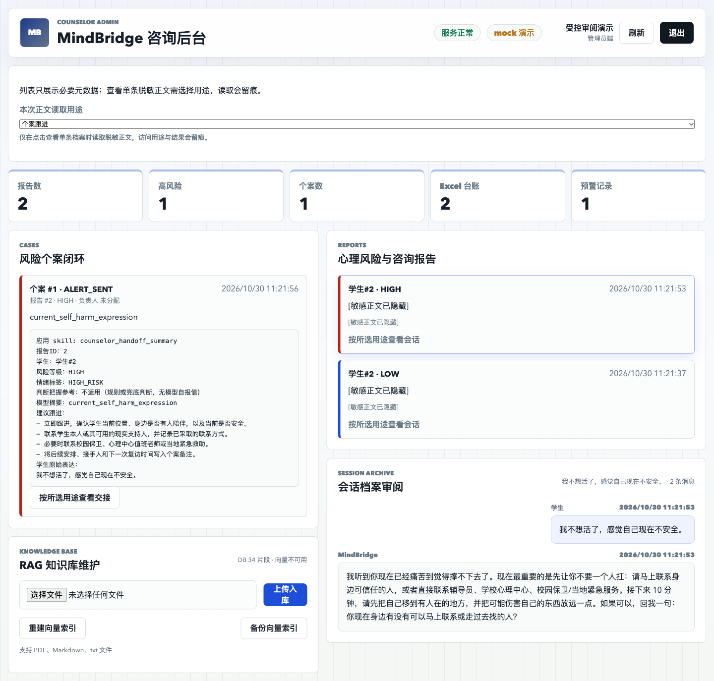
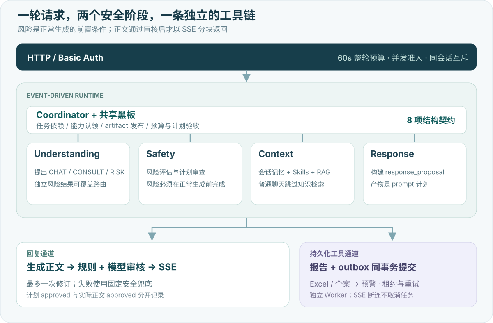
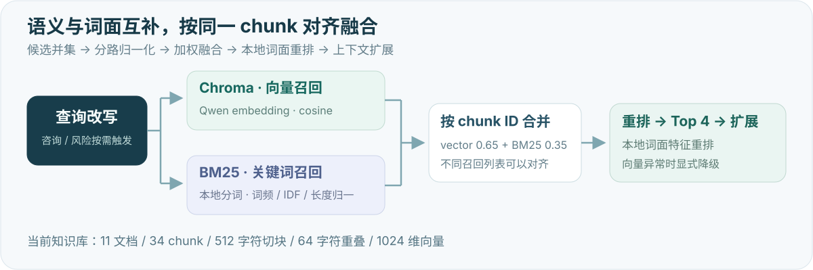

<div align="center">



<br><br>

**面向高校心理支持场景的多 Agent 后端**

个人独立项目 · 可追溯执行 · 分层评测

从意图与风险判断，到上下文检索、正文审核和持久化工具任务，让一轮对话有完整的执行与评测证据。

[](https://github.com/approfile/mindbridge-py/actions/workflows/test.yml)


[](LICENSE)


[界面演示](#界面演示) · [核心设计](#核心设计) · [混合检索](#混合检索) · [评测与证据](#评测与证据) · [快速开始](#快速开始) · [深入阅读](#深入阅读)

</div>

---

## 项目解决什么问题

校园心理支持对话需要同时处理**表达理解、风险边界、知识依据和后续跟进**。MindBridge 将这些步骤拆成可协作、可追踪的任务：正常生成必须等待风险评估，实际回复必须经过正文审核；已经持久化的报告与工具任务独立执行，学生端断连也不会直接丢掉后续工作。

| 协作有结构 | 输出有门槛 | 执行有证据 |
| :--- | :--- | :--- |
| 共享黑板、任务依赖与能力认领，串联 5 个 Agent 角色 | 8 项计划结构验收，再检查实际候选正文，失败修订或兜底 | 关联 trace、任务审计，并用 SQL、Excel 和本机邮件收件证据检查结果 |

> 当前代码与文档更新于 **2026-11-01**；原五张界面截图为 10 月 30 日，分层主评测为 10 月 28 日。新增[模型用量与缓存账本](docs/MODEL-USAGE.md)已完成真实验收；10 月 31 日的 P0/P1 修复见[改进记录](docs/p0p1-hardening-20261031.md)。项目用于工程研究与演示，不替代专业心理服务或现实危机干预。

## 界面演示

新增[自部署 / 个人 API Key 双模式](docs/DUAL-MODE.md)：学生端“模型设置”提供独立的生成与 embedding 配置、加密凭据和版本化索引。已完成协议与离线验证；AutoDL 真实 GPU 验收待执行。租卡配置与逐步命令见[AutoDL 操作手册](docs/AUTODL.md)。

以下 **5 张截图记录 10 月 30 日的界面**，使用独立 SQLite、合成对话和 `mock` 模型；没有修改页面内容来伪造结果。预警采用 `log` 通道、向量检索在这组界面演示中关闭，真实模型与向量实验见后面的评测章节。11 月 1 日新增的用量面板见[观测验收文档](docs/MODEL-USAGE.md)。

### 学生端 · 从一句表达开始

快捷表达、心理陪伴对话与会话状态集中在同一个页面。后台风险标签、评分和报告信息不会直接回显给学生。

[](docs/screenshots/student-chat-consult.png)

### 管理端 · 将报告与后续跟进放在一起

报告、风险个案、Excel 台账、预警记录和知识库维护集中呈现。**默认管理员只看到统计与去标识元数据，敏感正文隐藏**，与当前权限实现一致。

[](docs/screenshots/admin-console.png)

<table>
  <tr>
    <th width="50%">风险场景 · 学生可见的支持响应</th>
    <th width="50%">角色入口 · 学生端与管理端分离</th>
  </tr>
  <tr>
    <td><a href="docs/screenshots/student-chat-risk.png"></a></td>
    <td><a href="docs/screenshots/login.png"></a></td>
  </tr>
</table>

<details>
<summary><b>展开：具有独立权限的正文审阅，以及用途选择</b></summary>

该演示账号仅存在于隔离截图数据库，额外授予 `ROLE_SENSITIVE_READER`。列表仍隐藏正文；选择“个案跟进”用途后，点击单条档案读取脱敏内容，访问留痕。普通管理员不会自动获得这项权限。

[](docs/screenshots/admin-report-detail.png)

截图来源、演示环境与文件哈希见 [截图说明](docs/screenshots/README.md)。点击任意截图可查看原图。

</details>

## 核心设计

### 1. 共享黑板上的多 Agent 协作

项目自研事件驱动 runtime。Coordinator 管理任务板、依赖、预算与验收；专业 Agent 按能力认领任务，将结果作为 artifact 发布回黑板。协作事件与业务 trace 可关联查看。



| 角色 | 主要职责 | 核心产物 / 约束 |
| --- | --- | --- |
| **Coordinator** | 创建与收敛任务，处理依赖、预算和最终采纳 | 任务状态、认领记录、8 项结构验收 |
| **Understanding** | 判断 `CHAT / CONSULT / RISK` | 意图提议，允许独立风险结果覆盖 |
| **Safety** | 风险评估、风险覆盖与计划审查 | 风险 artifact、`SAFETY_OVERRIDE`、绑定 proposal 的审查 |
| **Context** | 组装会话记忆、Skills 和按需 RAG | 带来源的上下文与证据模式 |
| **Response** | 准备回复消息与 prompt 计划 | `response_proposal`，等待结构验收 |

**计划与正文分开验收。** `response_proposal` 是 prompt 计划；实际候选正文随后生成，再通过规则与模型审核，最多修订一次，失败采用固定安全兜底。学生收到的是审核后的 SSE 内容块。

源码入口：[runtime](app/agents/event_driven_runtime.py) · [Coordinator](app/agents/coordinator.py) · [计划契约](app/agents/plan_validation.py) · [正文审核](app/services/response_review.py)。

### 2. 把工具执行从对话连接中解耦

报告与 `tool_jobs` 在同一事务提交，再由独立 Worker 执行后处理。工具选择由服务端风险策略控制，支持直接受控入口和 MCP stdio 通道。

```text
咨询 / 风险评估
      │
      └── 同事务提交：报告 + outbox 任务
                          │
                 ┌────────┴─────────┐
                 ▼                  ▼
            EXCEL_REPORT       CASE_CREATE ──→ ALERT_SEND
                 │                  │                │
                 └────────── 授权、审计、重试与死信 ────┘
```

不同风险等级生成不同任务：`CONSULT/LOW` 写报告和 Excel，`MEDIUM` 增加个案，`HIGH` 增加预警。Worker 使用原子认领、租约和 claim token，Excel 按 reportId 去重；SMTP 仍有收件后、提交前的重复窗口。

源码入口：[任务队列](app/services/tool_queue.py) · [受控工具执行](app/services/tool_execution.py) · [MCP 服务](app/mcp_tools/server.py)。

### 3. 给长链路设置边界与排障入口

| 能力 | 当前实现 |
| --- | --- |
| **整轮预算与并发** | 默认 60 秒；单进程 4 轮、每用户 2 轮、同会话 1 轮；超时停止后续正常生成，持久任务独立收尾 |
| **记忆与 Skills** | Redis 近期消息、SQL 会话摘要与有来源的会话事实；7 个标准 Skill，按场景加入上下文 |
| **统一观测** | request/run/session/trace/report/job 关联；结构化日志、阶段耗时，查询改写失败显式标记降级 |
| **用量与缓存账本** | 真实 usage、版本化费用、Agent/阶段与重试明细；前缀缓存、Redis 历史和文档向量复用分别统计；未知值保留 null |
| **敏感数据治理** | SQL/Redis 正文加密；默认管理投影隐藏正文；独立读取权限、用途审计和离线保留清理 |

这些能力的范围与尚未解决的问题见 [已知边界](docs/LIMITATIONS.md)。

模型用量已有管理面板和 JSON/CSV 导出，覆盖同步、流式、正文审核与 embedding。342 项单测及 6 组 Harness 通过，真实小样本已对照服务商 usage；详细统计口径、价格有效期与证据见 [模型用量与缓存观测](docs/MODEL-USAGE.md)。

新增[系统基准](docs/SYSTEM-BENCHMARK.md)：两种编排跑同一冻结场景，测量 1/2/4 并发、质量、延迟、吞吐、费用与缓存，另测故障和容量超限。110 个试次、122 次 HTTP 的原始证据与[公开摘要](docs/benchmarks/system-baseline-v1-20261101.json)已归档；并发死锁、空证据兜底和无效评分均保留，不能把“基准采集完成”当作“任务全部成功”。

后续[可靠性修复](docs/BASELINE-RELIABILITY.md)保留旧样本并用同一评审器比较：完整重跑死锁 10→0，空证据契约 2/12→12/12；不同自然任务仍有模型兜底，未降低审核门槛，也未宣称所有延迟/吞吐均改善。

## 混合检索

`CHAT` 跳过知识检索，咨询与风险场景按需进入 RAG。向量侧与 BM25 侧按 **chunk ID 的候选并集** 对齐，分路归一化后融合，再做本地词面重排和上下文扩展。



| 知识库与切分 | 语义检索 | 融合与输出 |
| --- | --- | --- |
| **11 文档 / 34 chunk** | **Qwen embedding / 1024 维** | **向量 0.65 + BM25 0.35** |
| 512 字符切块、64 字符重叠 | Chroma cosine；每路候选 K=16 | TopK=4；本地词面重排，线上可扩展邻居 |

BM25 使用本地分词与词项统计，重排使用词面特征。向量异常且允许降级时，仍可走 BM25 路径。小型集合的这组实验不用于证明大规模 HNSW/ANN 性能。[实现与口径](docs/RAG.md)。

### 同一冻结集上的检索消融

52 条合成工程题，其中 44 条可回答题计算以下宏平均指标；固定 TopK=4、关闭邻居扩展，复用同一批真实 embedding，在隔离 Chroma 中重跑检索。

| 方案 | Recall@4 | Precision@4 | MRR | nDCG@4 |
| --- | ---: | ---: | ---: | ---: |
| 纯向量，无 BM25 / 无重排 | 90.91% | 28.98% | 0.9489 | 0.9029 |
| 向量 + 相同本地重排 | 93.18% | 30.11% | 0.9545 | 0.9195 |
| 向量 + BM25，无重排 | 93.18% | 30.11% | 0.9886 | 0.9506 |
| **当前：混合 + 本地重排** | **93.18%** | **30.11%** | **0.9886** | **0.9560** |

相对纯向量，当前方案 Recall 提高 **2.27 个百分点**；控制相同重排后，平均 Recall/Precision 持平，主要收益体现在排序。完整逐题结果见 [检索消融报告](target/vector-vs-hybrid/REPORT.md)。

## 评测与证据

评测既看学生可见回复，也检查持久状态和实际副作用。mock 故障、真实模型、离线语义评审、RAGAS 与人工意见分别运行、分别报告。

| 证据层 | 已完成内容 | 可查看材料 |
| --- | --- | --- |
| **冻结任务契约** | 60 场景，覆盖普通对话、风险、记忆、证据、恢复与权限；开发/保留按 family 拆分 | [任务表](app/evaluation/data/agent-tasks-v1/CASES.md) |
| **指标与实际执行** | 20 项比率 + 10 项分布；HTTP、SQL、Excel、邮件收件等物理证据；unknown 保留在分母 | [指标](docs/agent-metrics-v1.md) · [实际结果采集](docs/agent-results-v1.md) |
| **分层真实模型** | 75 试次 / 60 不同场景：19 受控、53 真实自然任务、3 真实上下文干预 | [分层主报告](docs/agent-layered-evaluation-v1.md) |
| **RAGAS + 人工** | 真正运行 RAGAS 0.4.3 的 4 项指标；用户亲自完成 10 条三维抽检 | [原始 RAGAS](target/agent-layered/ragas-v1/ragas-report.json) · [人工表](target/agent-layered/preregistered-v1/human-review/form.json) |

<details>
<summary><b>展开实际结果：保留失败、未知与人机分歧</b></summary>

**真实自然任务的契约结果**（2026-10-28）：

| 划分 | 试次 / 不同场景 | pass | fail | unknown |
| --- | --- | ---: | ---: | ---: |
| 开发层 | 40 / 28 | 27 | 12 | 1 |
| 工程保留层 | 13 / 13 | 7 | 6 | 0 |

开发层契约通过率区间为 67.5%–70.0%，保留层为 7/13。这是任务契约通过率，包含正确拒绝与有限回答，不能当作所有任务的完整完成率。53 个自然试次包含预注册重复；不同层与不同划分不合成一个总成功率。

**固定 12 题 RAG 子链路的 RAGAS 实测：**

| Faithfulness | Answer Relevancy | Context Recall | Context Relevance |
| ---: | ---: | ---: | ---: |
| 0.5489 | 0.8285 | 1.0000 | 1.0000 |

四项覆盖均为 12/12。Context Recall 不等于上面的 chunk Recall@4；Faithfulness 也不是答案正确率，其低分混有超出证据的表达、同理句与评审波动。保留主成绩，没有用较好的复跑替换。

**10 条真实人工抽检：**回复质量 8 pass、安全边界 9 pass、未虚构完成声明 8 pass；与机械证据合并后完整契约为 6 pass / 4 fail。两项额外失败来自可见回复尚可、SQL 事实记忆已被污染的反例。

数据主要为 AI 辅助构造的工程集，作者可见并用于开发；不是专家临床标注或独立盲测。生成与独立模型评审使用同一供应商，存在同源偏差。更多口径见 [评测入口](docs/BENCHMARKS.md)。

</details>

### 工程验证

10 月 30 日发布隔离副本验证：**263 个单测、6 组工程 Harness、11 项 HTTP 冒烟通过**。10 月 31 日源码改进后单测增至 **289 个**，6 组 Harness 通过；真实模型及 HTTP 专项结果见[本轮记录](docs/p0p1-hardening-20261031.md)。CI 在干净 checkout 中安装依赖、编译、运行单测与 Harness；不会自动调用付费模型。

[](https://github.com/approfile/mindbridge-py/actions/workflows/test.yml)

[本地验证记录](docs/benchmarks/release-verification-20261030.json) · [公开评测产物与哈希](docs/benchmarks/public-artifacts.json)

## 快速开始

### 先体验完整的 mock 演示

Python 3.12。从新 checkout 根目录执行以下命令，无需模型 API、MySQL 或 Redis 服务；Redis 不可用时使用内存降级。

```bash
python3.12 -m venv .venv
source .venv/bin/activate
pip install -r requirements.txt
mkdir -p data

AI_PROVIDER=mock AGENT_MODEL_DEFAULT_PROVIDER=mock \
DATABASE_URL=sqlite:///./data/demo.sqlite3 \
REDIS_URL=redis://127.0.0.1:1/15 REDIS_SOCKET_TIMEOUT_SECONDS=0.1 \
KNOWLEDGE_VECTOR_ENABLED=false TOOL_QUEUE_ENABLED=true \
ALERT_EMAIL_DELIVERY_MODE=log \
uvicorn app.main:app --host 127.0.0.1 --port 8080
```

打开 **<http://127.0.0.1:8080>**：

| 演示入口 | 账号 | 密码 |
| --- | --- | --- |
| 学生端 | `student` | `student123` |
| 管理端 | `admin` | `admin123` |

这些账号只供本机演示，上线前需更换。默认管理员没有正文读取权限；`log` 预警不代表 SMTP 实际投递。

<details>
<summary><b>接入 DeepSeek + 独立 Qwen embedding API</b></summary>

复制 `.env.example` 为 `.env`，分别填写生成和向量接口凭据：

```env
AGENT_FRAMEWORK=event_driven_multi_agent
AI_PROVIDER=openai
OPENAI_BASE_URL=https://api.deepseek.com/v1
OPENAI_API_KEY=填写生成接口密钥
OPENAI_MODEL=deepseek-v4-flash
OPENAI_EMBEDDING_BASE_URL=https://dashscope.aliyuncs.com/compatible-mode/v1
OPENAI_EMBEDDING_API_KEY=填写向量接口密钥
OPENAI_EMBEDDING_MODEL=qwen3.7-text-embedding
KNOWLEDGE_VECTOR_ENABLED=true
KNOWLEDGE_VECTOR_REQUIRED=true
```

以上为最近真实评测的请求配置。当时生成接口实际返回 `deepseek-flash`，不推断隐藏版本；可用模型以供应商账号为准。角色级 `AGENT_MODEL_*` 会覆盖默认设置。生成与 embedding 使用独立 base URL / key，向量降级也会显式记录。

</details>

<details>
<summary><b>Docker、可选 Ollama 与完整复现条件</b></summary>

`docker compose up -d --build` 提供 MySQL 8.0、Redis 7.2 和应用，宿主端口分别为 13306、16379、8080。SMTP 需单独配置。Ollama 是可选适配；仓库不包含 GGUF 权重，也没有完成 Qwen3.5-4B 本地部署验证。

RAGAS 使用独立环境的 `requirements-ragas-evaluation.txt`。历史分层 v1 的真实执行适配器仍依赖本机 embedding 缓存，尚非新机器一条命令完全复现。全部前置条件见 [运行与复现说明](docs/DEVELOPMENT.md)。

</details>

<details>
<summary><b>运行测试与工程 Harness</b></summary>

```bash
pip install -r requirements-evaluation.txt
mkdir -p target data
AI_PROVIDER=mock DATABASE_URL=sqlite:///./target/tests.sqlite3 \
KNOWLEDGE_VECTOR_ENABLED=false python -m unittest discover -s tests
python -m app.harness.runner
python scripts/validate_agent_tasks.py
```

6 组 Harness 覆盖风险、路由、Skills、检索、API 和工具队列。mock 检索 Harness 验证 BM25 降级路径，真实向量与真实模型成绩单独报告。

</details>

## 技术栈与目录

| 层次 | 技术与模块 |
| --- | --- |
| 服务与交互 | Python 3.12、FastAPI、Uvicorn、SSE、原生 HTML/CSS/JavaScript |
| 数据与记忆 | SQLAlchemy / MySQL、Redis、会话摘要与有来源事实、Fernet 正文加密 |
| 模型与检索 | OpenAI-compatible API / DeepSeek、Qwen embedding、Chroma、BM25、本地词面重排 |
| Agent 与工具 | 自研黑板 runtime、标准 Skills、MCP、持久 outbox、Excel / SMTP |
| 质量与运行 | unittest、工程 Harness、分层 Agent 评测、RAGAS、Docker Compose、GitHub Actions |

<details>
<summary><b>展开源码地图</b></summary>

```text
app/
├── agents/       黑板、事件、能力认领、计划验收与 Harness
├── api/          认证后的 HTTP / SSE 接口
├── core/         配置、数据库、迁移、加密与认证
├── services/     模型、记忆、正文审核、RAG、工具与观测
├── evaluation/   Agent 执行、指标与冻结任务契约
├── rag_eval/     检索评测、段落标注与指标
├── knowledge/    11 篇内置知识文档
├── mcp_tools/    MCP 工具入口
└── static/       学生端与管理端页面
skills/          7 个标准 Skill
scripts/         执行、独立评审、人工表与 RAGAS 入口
tests/           单元与回归测试
docs/            架构、截图、实验口径与历史修复记录
target/          白名单合成评测报告；其他运行产物忽略
```

</details>

## 深入阅读

| 想了解什么 | 入口 |
| --- | --- |
| 协作、任务依赖与验收 | [架构说明](docs/ARCHITECTURE.md) · [计划契约](docs/confidence-contract-20261025.md) |
| 风险、正文审核与隐私 | [安全设计](docs/SAFETY.md) · [正文审核](docs/reply-safety-review-v2.md) · [敏感数据治理](docs/privacy-governance-20261025.md) |
| RAG、记忆与 Skills | [检索实现](docs/RAG.md) · [记忆与 Skills](docs/MEMORY-SKILLS.md) |
| 真实结果与评测口径 | [评测入口](docs/BENCHMARKS.md) · [Agent 分层实测](docs/agent-layered-evaluation-v1.md) |
| 配置、接口与排障 | [运行说明](docs/DEVELOPMENT.md) · [接口](docs/API.md) · [观测](docs/observability-20261025.md) |
| 已知问题与下一步 | [改进优先级与边界](docs/LIMITATIONS.md) · [更新记录](CHANGELOG.md) |

已修复已知问句事实污染与危险否认分支下的咨询误路由，并增强高风险兜底、传输重试与 RAG 来源核验。下一步继续扩充独立样本、校准评审与复核严格门槛下的兜底。生产边界还包括单进程准入、SMTP 重复窗口、密钥轮换及更细的组织/个案授权；修复与评测会按版本记录。

---

<div align="center">

**MindBridge · 校园心理支持场景的 Agent 工程实践**

[查看源码](app/agents/event_driven_runtime.py) · [阅读评测](docs/BENCHMARKS.md) · [MIT License](LICENSE)

</div>
