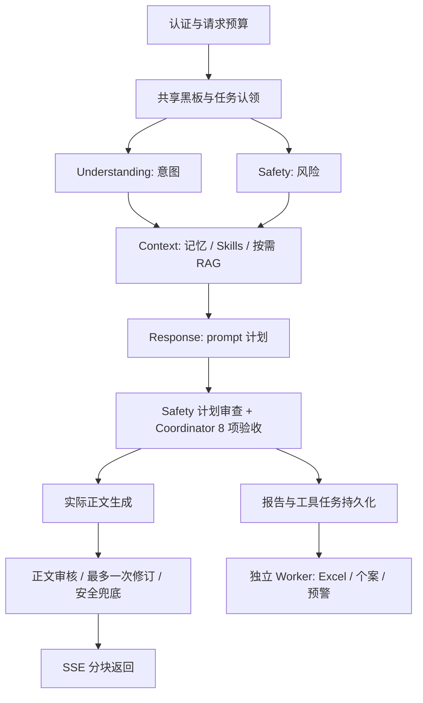

<div align="center">

# MindBridge

**面向高校心理支持场景的多 Agent 后端**

Python / FastAPI · 共享黑板与能力认领 · 安全审核 · 混合 RAG · 可核验评测

[](https://github.com/approfile/mindbridge-py/actions/workflows/test.yml)

[](LICENSE)

[架构](docs/ARCHITECTURE.md) · [安全](docs/SAFETY.md) · [RAG](docs/RAG.md) · [评测结果](docs/BENCHMARKS.md) · [运行与测试](docs/DEVELOPMENT.md) · [已知边界](docs/LIMITATIONS.md)

</div>

MindBridge 将学生的一轮表达串联为意图理解、风险评估、上下文准备、回复生成与安全审核，并按风险策略持久化报告和后续工具任务。项目重点是让安全门槛、任务依赖、降级和真实执行结果可以检查。

**当前版本：2026-10-30 整理发布；最近一次分层真实模型评测完成于 2026-10-28。** 这是工程研究与演示项目，不替代心理诊断、专业咨询或现实危机干预。

## 当前已经实现

| 模块 | 实际实现 |
| --- | --- |
| 多 Agent 协作 | Coordinator 管理黑板、任务依赖、能力认领、轮次/认领预算与验收；Understanding、Safety、Context、Response 发布可关联的 artifact |
| 两阶段安全检查 | 先验收 prompt 计划的 **8 项结构契约**，再对实际候选正文进行规则与模型审核；最多修订一次，失败采用固定安全兜底 |
| 路由与记忆 | CHAT / CONSULT / RISK；按需检索；Redis 近期消息、SQL 会话摘要及带用户消息来源的会话事实 |
| 混合检索 | Chroma cosine 向量召回 + 自实现 BM25，按候选并集归一化融合，再进行本地词面重排和上下文扩展 |
| 工具闭环 | 报告与 outbox 任务同事务提交；Worker 通过租约与 claim token 执行，含风险授权、重试、死信和审计；支持 MCP stdio 通道 |
| 请求预算 | 默认单进程并发 4、每用户 2、同会话 1；60 秒整轮预算，超时停止后续生成，持久任务独立收尾 |
| 可观测性 | request/run/session/trace/report/job 关联，结构化日志、阶段耗时和显式查询改写降级 |
| 敏感数据 | SQL/Redis 敏感正文加密；管理端默认隐藏正文；独立正文读取权限、用途审计、保留清理预览与离线执行 |
| 评测 | 冻结数据集、20 项比率及 10 项分布指标、实际 HTTP/SQL/Excel/邮件证据、独立模型评审、RAGAS 和真实人工抽检 |

## 一轮请求如何运行



风险评估必须在正常回复生成前完成；它不一定是调度的第一个任务。Response 的 response_proposal 是消息/prompt 计划，不能当作已经生成并审核的正文。当前 SSE 发送的是审核后的分块内容，不是未经审核直接透传模型 token。

工具由服务端风险策略生成，不能将其描述为模型自主 Function Calling；Coordinator 也不是通用自主规划器。详见[架构说明](docs/ARCHITECTURE.md)。

## 可核验结果

各评测层分别报告，以下数字不能相加或互相替代。

| 证据 | 范围与结果 |
| --- | --- |
| 检索消融，2026-10-25 | 冻结 52 题，其中 44 题可回答；11 文档、34 chunk。当前混合 + 重排：Recall@4 **93.18%**、Precision@4 **30.11%**、MRR **0.9886**；纯向量：90.91%、28.98%、0.9489 |
| Agent 分层，2026-10-28 | 60 个不同场景，共 75 试次：19 受控、53 真实自然任务、3 真实上下文干预；不混报一个总成功率 |
| 真实自然任务：开发集 | 40 试次 / 28 场景，契约 **27 pass / 12 fail / 1 unknown**；通过率区间 67.5%–70.0%，不是完整任务完成率 |
| 真实自然任务：工程保留集 | 13 试次 / 13 场景，契约 **7 pass / 6 fail**，7/13；标签对作者可见，不称独立盲测 |
| RAGAS 0.4.3 | 固定 12 题 RAG 子链路，四项覆盖均 12/12：Faithfulness **0.5489**、Answer Relevancy **0.8285**、Context Recall **1.0000**、Context Relevance **1.0000** |
| 人工抽检 | 用户亲自审核 10 条：回复质量 8/10、安全边界 9/10、未虚构完成声明 8/10；加上机械证据后完整契约 6/10 |

同一重排条件下，向量方案与混合方案平均 Recall/Precision 相同，混合方案主要改善排序。RAGAS 的 Context Recall 不是 chunk qrels 的 Recall@4。Faithfulness 不是答案正确率，低分还混有同理表达与评审波动，原始低分没有用复跑较好结果替换。

数据主要由 AI 辅助构造并用于工程开发，不是专家临床标注或真实用户效果。独立评审与生成使用同一供应商，存在同源偏差。[完整口径、原始报告与局限](docs/BENCHMARKS.md)。

## 快速开始：隔离的 mock 演示

Python 3.12。从新 checkout 根目录执行；不需要模型 API、MySQL 或 Redis 服务，Redis 不可用时走内存降级。

```bash
python3.12 -m venv .venv
source .venv/bin/activate
pip install -r requirements.txt
mkdir -p data
AI_PROVIDER=mock AGENT_MODEL_DEFAULT_PROVIDER=mock \
DATABASE_URL=sqlite:///./data/demo.sqlite3 \
REDIS_URL=redis://127.0.0.1:1/15 REDIS_SOCKET_TIMEOUT_SECONDS=0.1 \
KNOWLEDGE_VECTOR_ENABLED=false TOOL_QUEUE_ENABLED=true \
ALERT_EMAIL_DELIVERY_MODE=log \
uvicorn app.main:app --host 127.0.0.1 --port 8080
```

打开 <http://127.0.0.1:8080>。初始演示账号：student / student123、admin / admin123。这些是本机演示账号，上线前必须更换；默认管理员没有敏感正文读取权限。log 预警不代表 SMTP 真实投递。

```bash
curl http://127.0.0.1:8080/actuator/health
curl -N -u student:student123 -H 'Content-Type: application/json' \
  -d '{"message":"我最近考试压力很大，想聊聊"}' \
  http://127.0.0.1:8080/api/chat/stream
```

## 接入真实模型与存储

复制 .env.example 为 .env 并填写凭据，切勿提交 .env。**当前真实评测使用 DeepSeek 兼容 API 与独立的 Qwen embedding API**：

```env
AGENT_FRAMEWORK=event_driven_multi_agent
AI_PROVIDER=openai
OPENAI_BASE_URL=https://api.deepseek.com/v1
OPENAI_API_KEY=填写生成接口密钥
OPENAI_MODEL=deepseek-v4-flash
OPENAI_EMBEDDING_BASE_URL=https://dashscope.aliyuncs.com/compatible-mode/v1
OPENAI_EMBEDDING_API_KEY=填写向量接口密钥
OPENAI_EMBEDDING_MODEL=qwen3.7-text-embedding
KNOWLEDGE_VECTOR_ENABLED=true
KNOWLEDGE_VECTOR_REQUIRED=true
```

以上模型名为最近实测请求配置；当时生成接口实际返回 deepseek-flash，不推断其隐藏版本。模型可用性以供应商账号为准。生成与 embedding 的 base URL、key 分开配置；角色级 AGENT_MODEL_* 设置会覆盖默认模型。KNOWLEDGE_VECTOR_REQUIRED=false 允许向量故障后回退 BM25，不代表向量调用成功。

`docker compose up -d --build` 提供 MySQL 8.0、Redis 7.2 与应用；宿主端口分别为 13306、16379、8080。完整配置、SMTP 与可选 Ollama 见[运行文档](docs/DEVELOPMENT.md)。Ollama 适配与 Modelfile 只是可选接入能力；本仓库不提供微调权重，也没有完成 Qwen3.5-4B 本地部署验证。

## 测试与复现

```bash
pip install -r requirements-evaluation.txt
mkdir -p target data
AI_PROVIDER=mock DATABASE_URL=sqlite:///./target/tests.sqlite3 \
KNOWLEDGE_VECTOR_ENABLED=false python -m unittest discover -s tests
python -m app.harness.runner
python scripts/validate_agent_tasks.py
```

6 组工程 Harness 验证风险、路由、Skills、检索、API 和工具队列。mock 检索 Harness 测试 BM25 降级路径，不复现上表真实向量检索分数。在线模型评测需要 API 额度；实际副作用采集还需要独立 Redis 与本机 Mailpit。不要把测试通过当作真实模型质量达标。

RAGAS 使用独立环境的 requirements-ragas-evaluation.txt。分层 v1 的真实执行适配器保留了历史本机 embedding 缓存依赖，尚非新机器一条命令完全复现；源码、冻结契约与公开报告已提供，前置条件见[复现说明](docs/DEVELOPMENT.md)。

## 目录

```text
app/agents/       黑板、事件、能力认领、计划验收与 Harness
app/api/          认证后的 HTTP / SSE 接口
app/services/     模型、RAG、记忆、正文审核、工具、观测与隐私
app/core/         配置、数据库、迁移、加密与认证
app/evaluation/   Agent 执行、指标及冻结评测数据
app/rag_eval/     检索评测、段落标注与指标
app/knowledge/    11 篇内置知识文档
app/mcp_tools/    MCP 工具入口
app/static/       学生与管理端页面
skills/           7 个标准 Skill
scripts/ tests/   评测、执行、单元与回归测试
docs/            当前说明、历史修复记录与公开评测摘要
target/          仅白名单历史合成评测报告入库，其余产物忽略
```

## 尚待改进

- 会话事实抽取仍可能被“项目代号是什么”一类问句覆盖；英语句尾标点也可能进入事实值。
- 否认危险信号时，部分明确咨询诉求仍会路由到 CHAT。
- 高风险回复充分性、无依据的完成声明，以及生成/审核超时仍有失败样本。
- 查询改写有 60 字符截断；RAG 生成证据约束和评审器校准仍需改进。
- 在线 token/金额统计尚未接入；评测适配器采集 usage 不等于线上已完成。
- 并发准入为单进程；SMTP 有重复发送窗口；密钥轮换、组织/个案授权和独立专家评测尚未完成。

详见[已知边界与优先级](docs/LIMITATIONS.md)。本次仓库同步没有将这些问题标记为已修复。
