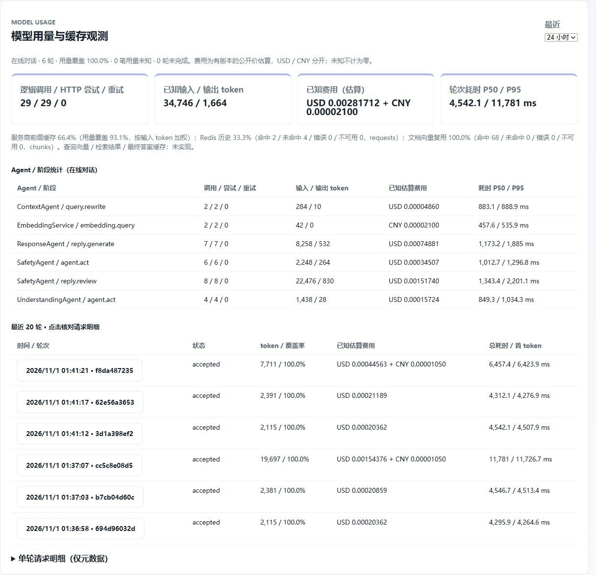
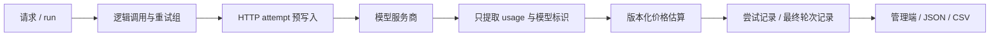

# 模型用量、费用与缓存观测

实施与验收日期：2026-11-01（Asia/Singapore）。阶段 1 已完成；性能与质量基准仍属于下一阶段。

## 查看与复现

应用启动后，使用管理员登录 `http://127.0.0.1:8080/admin.html`，查看“模型用量与缓存观测”。支持 24 小时、7 天、30 天的在线统计、Agent / 阶段表、最近 20 轮和单轮请求明细。学生账号不能读取这些接口，管理员读取仍写访问审计。



Windows 本机使用已有的启动脚本：

```powershell
.\scripts\start-local.ps1 -RealModels
docker compose -f docker-compose.local.yml exec -T app python scripts/verify_offline.py
# 使用已配置的云服务，会产生少量真实费用；只发送脚本中的虚构文本。
docker compose -f docker-compose.local.yml exec -T app python scripts/verify_model_usage.py
docker compose -f docker-compose.local.yml exec -T app python scripts/report_model_usage.py --hours 24 --scope online_chat --output target/usage-summary
docker compose -f docker-compose.local.yml exec -T app python scripts/report_model_usage.py --run-id <管理端显示的完整runId> --output target/usage-run
```

汇总导出 JSON，单轮导出 JSON 和逐次请求 CSV；CSV 的未知数值为空单元格。文件位于项目的 `target/`，不进入版本控制。无需修改已填好的 `.env`。

## 采集与存储

`model_gateway.py` 是统一计量边界，现有业务仍使用 `AiClient`。覆盖 OpenAI 兼容协议的同步、异步审核、SSE 流式和 embedding，以及 Ollama 的非流式与最终流式统计。



新增三张表，启动时通过现有 `create_schema` 创建，不改写历史聊天表：

| 表 | 内容 |
| --- | --- |
| `model_usage_runs` | 用户 ID、scope、关联 ID、轮次耗时、是否完成及汇总快照 |
| `model_usage_attempts` | 每次真实 HTTP 尝试、逻辑调用 ID、Agent、阶段、模型、服务商请求 ID、usage 和价格版本 |
| `usage_cache_events` | 分层缓存查找结果、原因、单位和查询耗时 |

attempt 在网络 I/O 前独立提交，结束时更新；中途进程退出会留下 `started`，不会伪装成完成。整轮收尾幂等，最终状态不能被较早的请求收尾覆盖。报告重新读取 attempt / cache 行聚合，避免把预写入时的过期汇总当最终用量。

ContextVar 隔离请求与重试组，共享的 Observation 在本轮工作线程间传递，锁保护收集与账本写入。`user_id` 来源于认证结果，request/run ID 由服务端生成。最终 trace 也带 `modelUsage` 快照；原来的评测调用计数接口保留兼容。

账本不保存提示词、回复、向量、API Key、Authorization 或原始异常消息。连接只记录协议 provider、host 和请求模型，不保存带凭据的 URL。实际模型字段仅表示服务商**实际返回的 model 字段**；服务商返回别名时，不能据此声称拿到了不可变权重版本。

## 统计口径

- **逻辑调用 / HTTP 尝试 / 重试**：一次受控传输重试组为一个逻辑调用；每次实际发请求为一个 attempt。该组额外尝试数为 `max(0, attempts - 1)`。正文修订或重新审核是新的逻辑调用，不冒充传输重试。mock 不产生真实 HTTP token 或费用记录。
- **token**：取供应商 usage 的输入、输出和总数；总数缺失但输入输出齐全时由两者求和。reasoning token 是输出的子集，不再加一次。embedding 的输出为协议定义的 0。计数非整数、负数或不满足已知不变量时标为 `invalid`。
- **流式 usage**：请求 `stream_options.include_usage=true`，同时识别有正文的最终块和没有 choices 的 usage 块；累计值替换，绝不逐块相加。长度截断时先读取末尾 usage 再拒绝候选。断流、取消和 HTTP 失败若未收到 usage，保留 unknown；请求失败也可能计费。
- **用量覆盖率**：`reportedUsageAttempts / recordedHttpAttempts`。汇总 token 是已知部分之和；没有任何有效字段时为 null。`tokensComplete=false` 表示不能把部分和说成完整总用量。已返回真实的 0 与缺失分开。
- **费用覆盖率**：`pricedAttempts / recordedHttpAttempts`；`cost.complete=false` 时仅展示已知部分。USD 和 CNY 分开求和，不进行隐式汇率换算，也不把未知请求的费用当 0。
- **耗时**：attempt 的 `durationMs` 从预写账本后开始，到读取/解析结束，包含传输与服务端生成；`firstTokenMs` 是底层流的首个非空正文块。整轮 `durationMs` 包含编排、持久化与收尾。`serverFirstTokenMs` 是服务端提交首个审核后文本块之前的时间，不是浏览器实际收字时间。并发/嵌套阶段的耗时不能直接相加。
- **P50/P95**：按最近秩法，表明样本数；整轮只使用 finalized 行，最多 2,000 条样本。当前小样本仅用于验证采集，不作为生产性能结论。

独立账本写入失败会输出 `usage.ledger_write_failed`（只有异常类型），在可保存的轮次快照中记录 `ledgerWriteErrors`。覆盖率仅针对已记录请求，不能证明账本完全失效期间没有发生调用；应结合服务日志核查。不是账单对账系统或无损遥测承诺。

## 缓存不是同一个指标

| 层 | 命中与分母 | 边界 |
| --- | --- | --- |
| 服务商前缀缓存 | `sum(cacheHitTokens) / sum(inputTokens)`，仅纳入返回完整缓存拆分的请求 | 由云服务商返回，按 token 加权；`cacheTokenCoverage` 为具备拆分的 attempt / 所有 attempt，embedding 通常没有此字段 |
| `redis_session_history` | `hits / (hits + misses)`，单位 requests | 仅在主会话历史加载时统计一次，需版本匹配且非空历史满足当前约束；过期/缺失为 miss，读异常为 error，未连接为 bypass，不将 Agent 私有列表读取重复计入 |
| `document_embedding_reuse` | `hits / (hits + misses)`，单位 chunks | 既有 SQL 向量的复用，或 Chroma 片段 ID 完整时保留现有索引；不是在线 query 缓存 |
| query embedding / 检索结果 / 最终答案 | 未实现，没有命中率 | 不使用 RAG Recall/HitRate 充当缓存命中率 |

错误和不可用单独展示，不偷偷算入正常命中率。文档向量旧字段尚无完整模型/维度/切分版本命名空间，这次只测量现有复用行为；切换 embedding 模型前仍需重建和后续版本隔离，不能据此声称跨模型复用正确。

## 价格版本与适用范围

默认目录为 `app/pricing/model-prices-v1.json`，`MODEL_PRICING_FILE` 可指定其他版本文件。保存 host、请求/返回模型白名单、操作类型、币种、单价、来源、有效起止时间。只接受明确匹配，代理 host 或未知别名不沿用别家的价格。

当前核对的来源为 [DeepSeek 官方定价](https://api-docs.deepseek.com/quick_start/pricing/) 和 [阿里云文本向量 API 定价](https://help.aliyun.com/zh/model-studio/text-embedding-synchronous-api/)。DeepSeek 流式字段见 [官方接口说明](https://api-docs.deepseek.com/api/create-chat-completion/)。

这版目录有效期为 2026-11-01 00:00 至 2026-11-08 00:00（UTC+8）。到期、模型不匹配、字段缺失或无法确定时段时，费用返回 unknown，不能自行延长价格有效期。DeepSeek 的工作日峰值窗口需核实节假日日历：目录中的 `verifiedPeakDatesUtc` / `verifiedHolidayDatesUtc` 为空时，相关窗口返回 `holiday_tier_unverified`；已知非峰值窗口正常估算。维护时应核对官方规则，再填入已核实的日期和新版本。

公式：`(cacheHitTokens × inputHit单价 + cacheMissTokens × inputMiss单价 + outputTokens × output单价) / 1,000,000`，使用 Decimal；embedding 按输入计费。公开标价估算不考虑免费额度、折扣、赠送、税费；自部署 Ollama 有 token，但基础设施成本未配置时费用仍是 unknown。

## 接口与分账

| GET 路径 | 参数与返回 |
| --- | --- |
| `/api/admin/model-usage-summary` | `hours=1..720`，默认 24；汇总、阶段、分位延迟、覆盖率、未完成轮次 |
| `/api/admin/model-usage` | `limit=1..100`，默认 20；最近轮次的真实重算汇总 |
| `/api/admin/model-usage/{run_id}` | 单轮关联、attempt 明细、cache 事件 |

前两者可选 `scope=online_chat`（默认）、`knowledge_index`、`http_model_operation`、`all`。启动索引与在线对话分开；真实验收的直接模型探针使用 `validation_probe`，可通过 all 或具体 run ID 检查，不计入在线统计。离线 judge/训练数据生成仍需在各自脚本显式绑定独立 scope，不会自动混入业务账本。

单次汇总最多读 20,000 attempts 和 20,000 cache events，超过上限返回 `truncated=true`，管理端明确提示；不能把截断数据称作完整账本汇总。目前使用 SQL 同步元数据写入，无新增平台依赖，尚未建设分布式遥测管道或账本自动保留清理。

## 本机验收证据

- 321 项单元/回归测试（新增 31 项）及 6 组工程 Harness。
- 真实直连探针：非流式、流式、embedding 共 3 次，逐项与供应商原始 usage 比较一致；只保存 usage/model/id，不保存完整响应。
- 最终在线验收三轮：CHAT、同会话后续消息、CONSULT；均为 accepted / SSE done，13 次 HTTP，12,217 token，用量和费用覆盖均为 100%，账本写入错误 0。
- 本批估算：USD 0.000861144；embedding CNY 0.0000105。前缀缓存按 11,588 个有拆分的输入 token 计算，命中 8,448，命中率 72.9%；另外 21 个 embedding 输入 token 不计入该分母。
- Redis：1 hit / 2 miss、无错误；34 个既有文档 chunk 复用、0 miss。没有清空共享缓存，首次观测不代表云端冷缓存。
- CLI 单轮 JSON/CSV 导出、管理员访问审计、学生 403，以及浏览器面板/时间切换/明细展开已验证。

本地原始证据：`target/model-usage-verification/20261031T174109Z/report.json` 和 `attempts.csv`；公开的简化摘要与哈希见 [验收摘要](evidence/model-usage-20261101.json)。同一脚本前一次验收为 16 次 HTTP、24,193 token、前缀缓存 63.1%，两批均完整记录。生成、审核和修订次数会变化，也存在云端热缓存；这不是优化前后实验，不能拿费用差异宣称降本收益。

下一步是冻结数据集和运行条件，建立质量 / 延迟 / 吞吐 / 成本基准，再决定优化哪个阶段。
